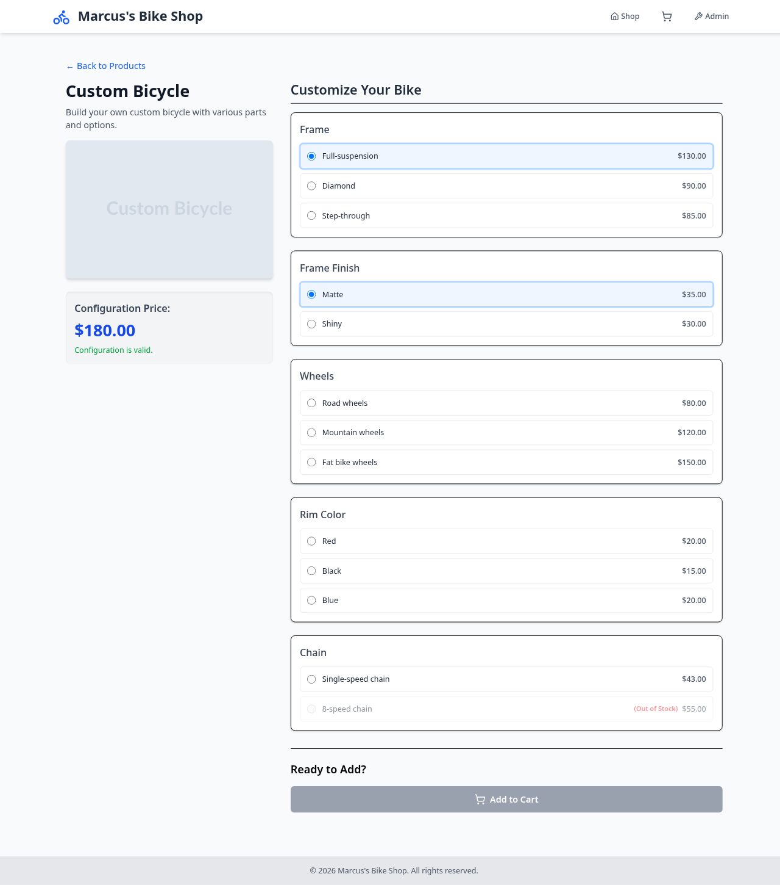
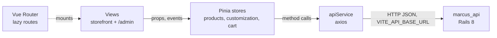

# Marcus's Bike Shop — configurator GUI

[](https://github.com/arkaitz97/marcus_gui/actions/workflows/ci.yml)
[](LICENSE)

This is the front end of a bike configurator: a Vue 3 single-page app with a
storefront and an admin area. The storefront lets a customer pick options, shows
whether the current selection is valid and what it costs, and sends the order.
The admin area maintains the same catalogue, the incompatibility pairs, the price
rules and the order statuses. It is deliberately a separate application from the
[API](https://github.com/arkaitz97/marcus_api) because the validity and pricing
rules must run on the server: the browser asks, it never decides. The result is a
small, readable SPA whose stores hold the client state and whose only authority is
one JSON API.



## Architecture



- `src/views/` holds the screens. `/admin` is a nested layout with child routes
  for products, parts, options, restrictions, price rules and orders.
- `src/stores/productStore.js` loads the catalogue: one product, then its parts,
  then the options of each part.
- `src/stores/customizationStore.js` holds the current selection and calls
  `validate_selection` and `calculate_price` after every change.
- `src/stores/cartStore.js` holds configured bikes and places one order per item.
- `src/services/apiService.js` is the only place that knows the API shape and the
  base URL.

## Stack

Vue 3 (`<script setup>`), Vite 6, Vue Router 4, Pinia 3, Tailwind CSS 4, Axios,
Lucide icons. Tests with Vitest, lint with ESLint and `eslint-plugin-vue`.

## Run locally

Requirements: Node 20 or later and a running `marcus_api` on port 3001.

```bash
git clone https://github.com/arkaitz97/marcus_gui
cd marcus_gui
npm ci
cp .env.example .env        # optional: the default points at localhost:3001
npm run dev
```

Open `http://localhost:5173`. The API seeds one product, so the shop and the admin
area have data on first load.

Start the API first:

```bash
cd ../marcus_api
bin/rails db:setup
bin/rails server -p 3001
```

`VITE_API_BASE_URL` overrides the API base URL at build time. The API allows the
`localhost:5173` origin in `config/initializers/cors.rb`; a different dev port
needs a matching CORS entry.

Product photographs are not part of the demo: the detail view requests a named
placeholder image.

## Tests

```bash
npm test          # Vitest, one run
npm run test:watch
npm run lint
npm run build
```

The suites cover the two stores that carry behaviour: adding, pricing and
removing cart items; refusing an incomplete configuration; placing one order per
item and keeping the cart when a call fails; and the validation and pricing
transitions of the customization store against a mocked API. There is no
component or end-to-end suite yet.

## Deploy

The output is static, so any static host works:

```bash
VITE_API_BASE_URL=https://api.example.com/api/v1 npm run build
```

Upload `dist/`. Two things must match the API deployment:

1. The build-time `VITE_API_BASE_URL` must point at the deployed API.
2. The API CORS configuration must allow the site origin.

The repository has no deployment workflow. `npm run build` produces the artifact;
serving it is a hosting decision.

## Documentation

- [Design](docs/design.md): context, goals, non-goals, routing and state design,
  alternatives.
- [ADR 0001](docs/adr/0001-server-authoritative-validation.md): why validity and
  price come from the API on every change.
- [ADR 0002](docs/adr/0002-storefront-stores-vs-local-admin-state.md): why only
  storefront state lives in Pinia.
- [Contributing](CONTRIBUTING.md) and [security policy](SECURITY.md).

## License

MIT. See [LICENSE](LICENSE).
